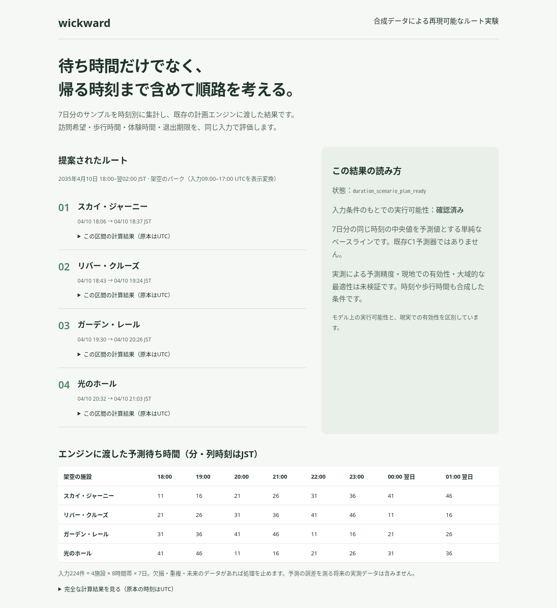
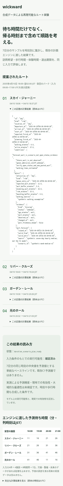
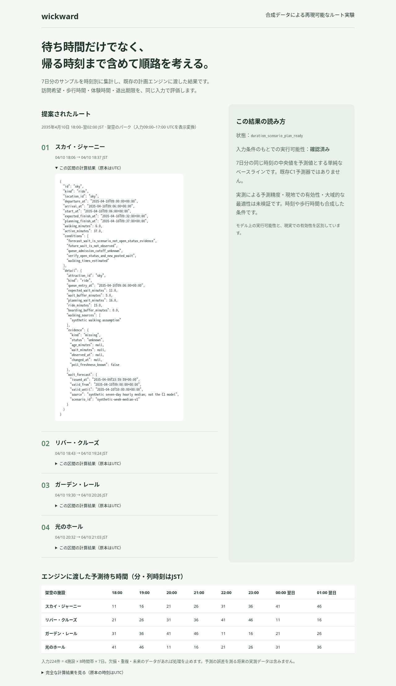

# wickward

A reproducible park-route experiment combining wait forecasts, walking time, and an exit deadline.
This public demo uses synthetic data and a bounded planning engine; real-world accuracy and global optimality are unverified.

**待ち時間だけでなく、帰る時刻まで含めて、パークの回り方を考える。**

## 課題 — 行きたい体験と、限られた時間を両立したい

ディズニーパークの回り方が複雑になり、混雑も気になるなかで、どの順番なら行きたい体験を回れるのか。
目の前の待ち時間が短い施設を選ぶだけでは、移動や体験にかかる時間、帰る時刻まで見通せません。
これが、この取り組みの出発点です。

目指しているのは、統計による待ち時間の見通しとルート探索をつなぎ、回り方を考える手がかりを作ることです。
wickwardは、そのための計画エンジンを合成データで試せる公開デモです。

【哲さん確認：名前の由来（ルミエールのロウソク）】

> **施設名・待ち時間・歩行時間・体験時間は合成です。** 実際の来園記録や外部サイトの観測データは含みません。
> 実測による予測精度・現地での有効性・大域的な最適性は未検証です。実際の営業時間や運休も反映していません。

## 解決のアプローチ — 予測と制約を、一つの計画につなぐ

```text
7日分の合成CSV → 施設・時刻別の中央値 → 訪問希望と時間制約を持つ入力
                                              ↓
                           候補の訪問順を探索 → 同じ条件で再評価 → JSON / HTML
```

公開デモでは、4施設 × 8時間帯 × 7日分の224件から、32件の予測値を作ります。
予測値に歩行時間、体験時間、必ず訪れたい施設、退出期限を合わせ、既存エンジンに渡します。
エンジンは与えられた施設の効用を評価し、制約を満たす候補の訪問順を探します。
「最短の待ち時間」だけで決めるのではなく、帰るまでの時間を含めて成立するかを確かめる構成です。

### 主要な設計判断と理由

以下は公開実装の構成と、その意味です。開発時に比較した代替案や採用経緯は、確認できたものと区別しています。

| 判断 | 理由・比較の観点 | 実装の根拠 |
| --- | --- | --- |
| 公開版の予測には時刻別中央値を使う | 同じ時刻の値をまとめる、読み解きやすいベースライン。高度な予測器の精度を主張せず、計画までの接続を試す | [`demo.py:23`](demo.py#L23) |
| 欠損を0分に補完せず、入力を拒否する | 不明な待ち時間を「すぐ乗れる」と解釈するのを避ける。重複・未来の観測・不正な値も拒否する | [`demo.py:27`](demo.py#L27) |
| 探索回数に上限を設け、結果を再評価する | 候補の挿入・順序変更で探索し、入力条件のもとで実行可能かを確認する。全候補の網羅や大域最適性は保証しない | [`plan_common.py:16`](engine/wickward-preplan-handoff-v1/_vendor/engine_api/plan_common.py#L16)、[`preplan_handoff.py:51`](engine/wickward-preplan-handoff-v1/preplan_handoff.py#L51) |
| 予測値・仮定・計算結果を分けて残す | 結果だけでなく、どの入力で成立した計画かを追えるようにする。エンジンは変更せず、公開用処理を外側に置く | [`demo.py:55`](demo.py#L55)、[来歴](docs/provenance.md) |

このデモの探索評価上限は500回、意図的に待つ候補の対象は開始から30分以内です（[`demo.py:97`](demo.py#L97)）。
待ち時間・退出時刻に各5分の余裕を置きますが、これも実測から求めた値ではなく合成の設定です（[`demo.py:64`](demo.py#L64)）。

【哲さん確認：開発時に比較した代替案と採用理由】

### 統計手法・参考研究の扱い

公開版で実行する統計手法は、施設ごとの同時刻の中央値です。既存のC1予測器は含めていません。
参照した文書・コードでは引用できる論文名を確認できなかったため、論文に基づく性能や、研究手法を再現したという主張はしていません。

【哲さん確認：参考にした論文】

## 工夫したところ — 順路と、その根拠を一緒に読める

### 帰る時刻まで含めた順路を見せる

訪問順と到着・終了時刻を並べ、右側には結果の読み方と未検証の範囲を添えています。
画面の時刻と予測表はJSTで表示します。入力の09:00〜17:00 UTCを変換するため、表示は18:00〜翌02:00です。
架空の時間条件であり、実際のパークの営業時間を示していません。



### 数字の内訳を隠さない

各区間の「計算結果」を開くと、歩行・予測待ち時間・余裕時間・体験時間などを確認できます（[`demo.py:74`](demo.py#L74)）。
表示用に時刻を変換しても、計算詳細と保存JSONは原本のUTC表記を維持します。
モバイルでは縦に読み進め、予測表は横スクロールできます。





## AIの使い方 — 作業と判断を分けて記録する

| 範囲 | AIツールが行ったこと | 哲さんが決めたこと・レビュー状況 |
| --- | --- | --- |
| 今回のREADME整備 | Codexが公開実装と参照文書を照合し、README草案、HTMLのJST表示、画面撮影、テスト実行を担当 | 哲さんが課題の方向性、合成データの明示、未検証事項を誇張しないことを指定。成果物はPRでレビュー待ち |
| 既存エンジン・予測研究の開発 | 使用ツールと担当範囲は、確認した資料から確定できない | 【哲さん確認：既存開発でAIが担当した作業／哲さんが決めた・レビューした範囲】 |

## 品質の担保

公開用テスト7件＋既存duration inputテスト26件、計33件の成功を再確認しました。
入力検査、エンジン接続、入力の非破壊性、HTMLエスケープに加え、JSTの日付またぎ表示を確認しています。
CIはPython 3.11でunittestを2系統と`demo.py`を実行します（[CI設定](.github/workflows/check.yml)）。
今回の実行環境・画面確認・制約は[動作確認](docs/verification.md)に記録しています。

## 技術構成と動かし方

Python 3.11以降、標準ライブラリのみで実行できます。画面は単体のHTML/CSSで、外部APIや地図を読み込みません。

```sh
python3 demo.py
```

生成された`output/route.html`をブラウザで開きます。[計算済みHTML](output/route.html)も同梱しています。
GitHubのファイル表示では実行できないため、ダウンロードして開くか、ローカルで再生成してください。

| ファイル | 内容 |
| --- | --- |
| [`demo.py`](demo.py) | 合成CSVの検査・中央値予測・入力変換・HTML出力 |
| `engine/` | 抽出した既存の計画エンジン（今回変更なし） |
| `output/forecast.json` | 時間帯ごとの予測待ち時間 |
| `output/request.json` | エンジンに渡した条件と合成の仮定 |
| `output/route.json` | 計算結果と検証条件 |
| `output/route.html` | 訪問順・予測表・展開できる計算詳細 |

```sh
python3 -m unittest discover -s tests -v
python3 -m unittest discover -s engine/wickward-preplan-duration-input-v1 -p 'test_*.py' -v
```

次の検証課題は、利用条件を確認した実測データで予測誤差を測り、訪問順や退出時刻に与える影響を確かめることです。

[従来のREADME](docs/readme-original.md) · [来歴](docs/provenance.md) · [動作確認](docs/verification.md)
