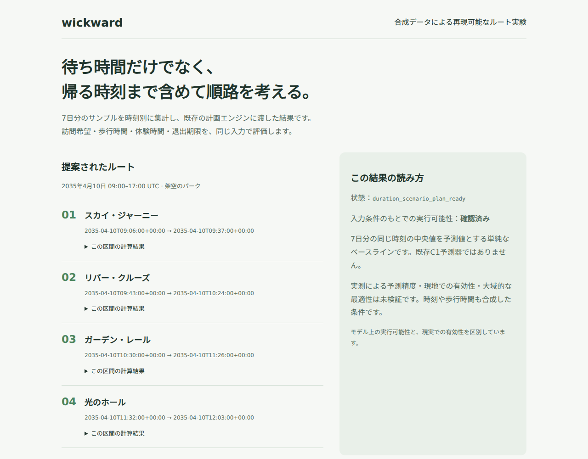

# wickward

待ち時間、歩行時間、体験時間、退出期限を考慮して、パーク内の訪問順を計算するエンジンです。
この公開版では、7日分の合成データから待ち時間の予測値を作り、既存エンジンでルートを計算してHTMLに出力します。



## 解決したい課題

待ち時間が短い場所を選ぶだけでは、行きたい体験を回りきれないことがあります。
移動に時間がかかったり、次の予定に間に合わなくなったりするためです。

wickwardでは、訪問希望と時間の制約を一つの入力にまとめます。
候補となる順路を評価し、計画を作ったあとに、同じ条件で実行可能かを確認します。
予測値や移動時間に仮定がある場合は、その条件も結果に残します。

## このデモで見せること

入力は4施設、8時間帯、7日分の224件です。
施設ごとに同じ時刻の中央値を取り、翌日の待ち時間の予測値として使います。
その予測値を既存の計画エンジンに渡し、訪問順と到着・終了時刻を計算します。

欠損や重複、不正な値、予測時点より未来のデータがあれば処理を止めます。
不明な待ち時間を0分として進めないようにしています。
入力、予測、計算結果をそれぞれJSONに保存するため、どの値からルートを作ったかを確認できます。

## 試す

Python 3.11以降を使います。
このデモは標準ライブラリだけで実行できます。

```sh
python demo.py
```

生成された`output/route.html`をブラウザで開きます。
計算済みのHTMLも[リポジトリに同梱](../output/route.html)しています。
GitHubのファイル表示画面ではHTMLを実行できないため、ダウンロードして開くか、ローカルで再生成します。

| 出力 | 内容 |
| --- | --- |
| `output/forecast.json` | 時間帯ごとの予測待ち時間 |
| `output/request.json` | エンジンに渡した条件 |
| `output/route.json` | 計算結果と検証条件 |
| `output/route.html` | 訪問順と予測値を読む画面 |

```sh
python -m unittest discover -s tests -v
python -m unittest discover -s engine/wickward-preplan-duration-input-v1 -p 'test_*.py' -v
```

## 予測と検証の範囲

施設名、待ち時間、歩行時間、体験時間は合成したものです。
実際の来園記録や、外部サイトから収集した観測データは含みません。

7日分の中央値は、処理のつながりを試すために追加した単純な予測です。
既存のC1予測器は、この公開版には含めていません。
今回確認できるのは、入力条件のもとでルートを計算し、結果を再評価できることです。
実測による予測精度、現地での有効性、大域的な最適性は未検証です。

今後は、利用条件を確認した実測データで予測の誤差を測り、その誤差が訪問順や退出時刻に与える影響を検証したいと考えています。

## コードを読む

[`demo.py`](../demo.py)に、7日分の入力検査、予測、エンジンへの変換、HTML出力をまとめています。
`engine/`には既存の計画エンジンを抽出し、ソースを照合するハッシュも残しています。
計画エンジンを書き換えず、公開用の入力処理を外側に追加した構成です。

抽出元は[来歴](provenance.md)、確認結果は[動作確認](verification.md)に記載しています。
