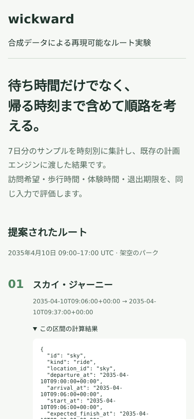

# 動作確認

2026年10月28日、Python 3.12で確認しました。
公開用の入力検査と接続テスト7件、既存duration inputのテスト26件が成功しています。
`python demo.py`で224件の合成入力から32件の予測値を作り、4施設のルートとHTMLを生成できました。

| 確認内容 | 結果 |
| --- | --- |
| 完全な7日分から時刻別中央値を計算 | 成功 |
| 欠損・重複・未来の観測を拒否 | 成功 |
| NaN・無限大・範囲外の待ち時間を拒否 | 成功 |
| 既存エンジンによるルート計算と再評価 | 入力条件のもとで実行可能 |
| 計算前後で入力が変更されない | 確認済み |
| HTMLに出す文字列のエスケープ | 確認済み |
| 4区間の表示と計算詳細の展開 | 成功 |
| モバイル幅でページ全体が横にはみ出さない | 確認済み |

画面はローカルのChromiumで1280×1000と390×844を確認しました。
予測表は横スクロールできる構成です。
画像、地図、外部APIを読み込まず、HTML単体で表示できます。

この検証は実測データに基づく予測精度を示しません。
営業時間や運休の実情報も入力していないため、現地で使えるルートであるとは判断していません。
探索回数に上限があり、大域的な最適性は保証しません。

